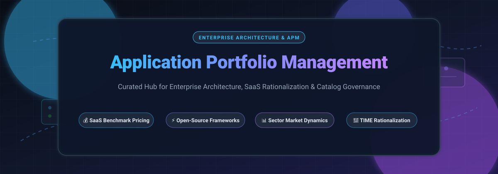

# 🏛️ Awesome Application Portfolio Management (APM) & Enterprise Architecture

**A curated directory of leading SaaS tools, open-source software catalogs, enterprise architecture frameworks, benchmark pricing, and market intelligence for modern Application Portfolio Management (APM).**

---

## 📑 Table of Contents

- [🔍 Overview](#-overview)
- [📈 Sector Overview & Market Dynamics](#-sector-overview--market-dynamics)
- [☁️ Commercial & Enterprise SaaS Solutions](#️-commercial--enterprise-saas-solutions)
- [🔓 Open-Source Frameworks & Tooling](#-open-source-frameworks--tooling)
- [🧭 APM Evaluation & TIME Rationalization Framework](#-apm-evaluation--time-rationalization-framework)
- [🤝 Contributing](#-contributing)
- [📜 License](#-license)

---

## 🔍 Overview

**Application Portfolio Management (APM)** is the strategic discipline of cataloging, evaluating, scoring, and rationalizing an organization’s business application inventory. APM enables Chief Information Officers (CIOs), Chief Technology Officers (CTOs), and Enterprise Architects (EAs) to eliminate redundant software licenses, retire high-risk legacy tech debt, map dependencies across business capabilities, and align IT investment roadmaps directly with corporate strategic goals.

---

## 📈 Sector Overview & Market Dynamics

The global **Enterprise Architecture (EA) and Application Portfolio Management software market** is estimated at **$1.20 billion to $1.27 billion in 2024–2025** (within the broader **$8.8B+ Project & Portfolio Management** ecosystem), growing at a compound annual growth rate (**CAGR of 5.5% to 7.0%**). The sector exhibits **moderate concentration with strong platform consolidation**; mega-suite providers (e.g., ServiceNow and SAP via its LeanIX acquisition) anchor core IT and ERP estates, while specialized independent leaders (Planview, Bizzdesign, Ardoq) capture dedicated architecture and multi-cloud portfolio rationalization workloads.

---

## ☁️ Commercial & Enterprise SaaS Solutions

The table below lists prominent commercial APM and Enterprise Architecture platforms, sorted in descending order by **Company Scale (Revenue / Valuation)**.

| 🏢 Platform | 🌐 Primary Focus | 💰 Starting Tier Pricing | 🎁 Free Tier / Trial Limits | 📊 Company Scale (Revenue / Valuation) |
| :--- | :--- | :--- | :--- | :--- |
| **[ServiceNow APM / SPM](https://www.servicenow.com/products/application-portfolio-management.html)** | Enterprise Digital Workflow, ITOM/ITSM Integration & Strategic Portfolio Management | **$70 – $95 / fulfiller user / month** (negotiated starting benchmark via enterprise agreement) | **No open free tier or public self-serve trial**; private sandboxes provided via enterprise Proof of Concept (PoC) | **~$10.0B ARR / ~$190B+ Market Cap** (NYSE: NOW) |
| **[SAP LeanIX](https://www.leanix.net/)** | Continuous Automated IT Landscape Discovery, SaaS Management & Enterprise Architecture | **~$26,000 / year** (entry tier; Vendr median enterprise contract: **$58,456 / year** based on app volume) | **No free tier or public free trial**; guided demo & scoped enterprise evaluation sandbox only | **~$36.0B SAP Global Revenue / ~$400M–$1.2B LeanIX Acquisition Valuation** |
| **[Planview Portfolios](https://www.planview.com/products-solutions/products/portfolios/)** | Strategic Portfolio Management, Enterprise Architecture & Investment Prioritization | **~$35 – $50 / user / month** (contracted annually on work management tiers; enterprise suite via quote) | **30-day fully functional free trial** for companion work management tiers (AgilePlace/ProjectPlace); enterprise suite via demo only | **~$450M ARR / ~$1.6B Valuation** (TPG & TA Associates backed) |
| **[CAST Imaging & Highlight](https://www.castsoftware.com/)** | Automated Software Intelligence, Source Code Architecture Mapping & Technical Debt Scoring | **$300 – $600 / scanned application / month** (Highlight SaaS tier; custom volume discounting) | **No permanent free tier**; 30-day guided Proof of Value (PoV) sandbox on up to 5 enterprise codebases | **~$150M ARR / ~$500M+ Valuation** (Bridgepoint backed) |
| **[Bizzdesign Horizzon](https://bizzdesign.com/)** | Collaborative Business Design, Strategy Mapping (ArchiMate / TOGAF) & MEGA/Alfabet Suites | **~€5,000 / year** (~$5,500 base package starting tier; modeler seats add ~€100–€180/user/month) | **No public self-service free trial**; structured 14 to 30-day guided enterprise Proof of Concept | **~€110M (~$120M) Combined ARR / ~$600M+ Private Valuation** (Main Capital backed) |
| **[Ardoq](https://www.ardoq.com/)** | Dynamic Graph-Driven Enterprise Architecture, Automated Survey Crowdsourcing & Next-Gen APM | **~$5,000 / month** (~$60,000 / year starting enterprise package; includes unlimited viewer users) | **No self-serve free trial**; structured guided pilot (typically 30 days) arranged through solutions architects | **~$36M ARR / ~$300M Valuation** (Series D funded by EQT Growth & One Peak) |
| **[Sparx Systems Enterprise Architect](https://sparxsystems.com/)** | Full-Lifecycle UML / SysML / ArchiMate Desktop & Cloud Repository Modeling Platform | **$320 one-time perpetual license** (Professional edition; $239/year subscription tier) | **30-day fully functional trial** (unrestricted features across all editions, diagram export includes watermark) | **~$25M Revenue / Independent Bootstrapped** |

---

## 🔓 Open-Source Frameworks & Tooling

Self-hosted and developer-friendly alternatives to inventory software services, visualize system topologies, track architecture artifacts, and govern IT assets. Repositories are sorted in descending order by **GitHub Star Count**.

| 📦 Repository & Project | 🌟 Stars | 📋 Description | 💻 Tech Stack |
| :--- | :--- | :--- | :--- |
| **[Backstage](https://github.com/backstage/backstage)** |  | Open framework developed at Spotify for building developer portals, software catalogs, and application ownership matrices. | TypeScript, React, Node.js |
| **[Snipe-IT](https://github.com/grokability/snipe-it)** |  | Full-featured IT asset management (ITAM) platform for auditing software licenses, digital assets, hardware allocations, and lifecycle status. | PHP, Laravel, MySQL |
| **[GLPI Project](https://github.com/glpi-project/glpi)** |  | Open-source enterprise service desk, CMDB, and software auditing tool for tracking multi-department application inventory and compliance. | PHP, MariaDB, Docker |
| **[Arc Kit](https://github.com/tractorjuice/arc-kit)** |  | Enterprise architecture governance harness for managing IT strategy, application architecture, delivery, and automated assurance. | Python, AI CLI, Markdown |
| **[Archi](https://github.com/archimatetool/archi)** |  | Dedicated open-source modeling tool implementing the open ArchiMate standard for cross-organizational enterprise architecture and portfolio mapping. | Java, Eclipse RCP |
| **[Modelio](https://github.com/ModelioOpenSource/Modelio)** |  | Extensible open-source modeling environment supporting TOGAF, ArchiMate, UML, and BPMN for comprehensive enterprise system modeling. | Java, C++, Eclipse RCP |
| **[OpenFlowKit](https://github.com/openflowkit/openflowkit)** |  | Local-first architecture canvas supporting C4, Structurizr, and Mermaid schemas to document distributed application inventories without external data leaks. | TypeScript, Web Standards |

---

## 🧭 APM Evaluation & TIME Rationalization Framework

Enterprise architects frequently leverage Gartner's **T.I.M.E. framework** to systematically analyze and classify applications within their portfolio:

| 🏷️ Strategy Quadrant | 💡 Criteria & Technical Health | 🎯 Recommended Action |
| :--- | :--- | :--- |
| **T — Tolerate** | High business value, low technical quality / high maintenance overhead | Keep in operation for current utility, minimize new investments, and plan for eventual replacement. |
| **I — Invest** | High business value, modern tech stack, scalable cloud architecture | Prioritize capital allocation, expand capability coverage, and integrate with core operational systems. |
| **M — Migrate** | High technical capability, low business alignment or redundant functional duplicate | Re-platform, consolidate into standard core solutions, or move workloads to standard SaaS offerings. |
| **E — Eliminate** | Low business value, obsolete tech debt, high security risk or zero active usage | Decommission immediately, archive regulated records, and reallocate licensing budget to strategic projects. |

---

## 🤝 Contributing

Contributions are always welcome! 

1. 🍴 Fork the repository.
2. 🌿 Create your feature branch (`git checkout -b feature/awesome-apm-tool`).
3. 💾 Commit your changes (`git commit -m 'feat: add new APM platform'`).
4. 🚀 Push to the branch (`git push origin feature/awesome-apm-tool`).
5. 📬 Open a Pull Request.

Please ensure added SaaS platforms include explicit benchmark pricing and free tier/trial data, and open-source tools link directly to active repositories.

---

## 📜 License

Distributed under the [MIT License](file:///C:/Users/ishan/Documents/Projects/Awesome-Application-Portfolio-Management/LICENSE). See `LICENSE` for more information.
